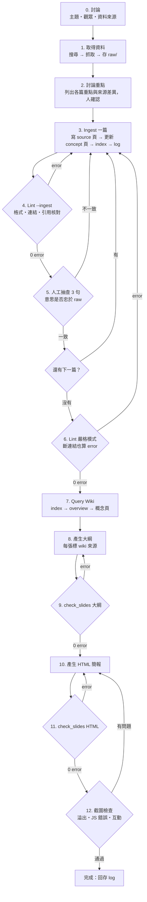

# Loop／Graph 設計說明與反思

主題：AI Agents｜Wiki 架構：Karpathy LLM Wiki（raw → wiki → schema）
本文件根據 `wiki/log.md` 中這次實際執行的紀錄撰寫。

---

## 一、整體流程（Graph）



純文字版：

```
討論 → 取得資料 → 討論重點 → ┌→ Ingest 一篇 → Lint → 人工抽查 ─┐ → 嚴格 Lint
                             └──────── 下一篇／修正 ←───────────┘
     → Query Wiki → 大綱 → 檢查大綱 → 產生 HTML → 檢查 HTML → 截圖檢查 → 完成
                    ↑_________|        ↑___________|___________|
```

### 各節點說明

| 節點 | 輸入 → 輸出 | 由誰做 | 檢查方式 |
|---|---|---|---|
| 0 討論 | 作業說明 → 主題、觀眾、資料來源 | 人 + LLM | 人選擇 |
| 1 取得資料 | 搜尋結果 → `raw/` 7 份（檔頭記 URL、日期、取得方式） | LLM + WebSearch/WebFetch | 檔頭格式 |
| 2 討論重點 | raw → 重點表、來源差異、概念頁清單 | LLM 提案，人確認 | 人確認 |
| 3 Ingest | 1 篇 raw → source 頁 + concept 頁 + index + log | LLM | 下一步 |
| 4 Lint | wiki/ → error 清單 | `tools/lint.py --ingest` | 自動 |
| 5 人工抽查 | 隨機 3 句 → 對照 raw | 人／LLM | 人工 |
| 6 嚴格 Lint | 全部 wiki | `tools/lint.py` | 自動 |
| 7 Query | index.md → 相關概念頁 | LLM | — |
| 8 大綱 | Wiki → `slides/outline.md`（14 張，每張 `wiki:`） | LLM | 下一步 |
| 9／11 簡報檢查 | 大綱或 HTML → error 清單 | `tools/check_slides.py` | 自動 |
| 10 產生 HTML | 大綱 → `slides/index.html`（每張 `data-wiki`） | LLM | 下一步 |
| 12 截圖檢查 | HTML → 14 張截圖 + 溢出／JS 錯誤報告 | headless Chrome | 自動 + 目視 |

### 自動檢查的規則

**`tools/lint.py`（Wiki）**
- frontmatter 必須有 title／type／sources／updated；sources 要指向真的存在的 raw
- 概念頁、比較頁的每一句事實句都要有 `〔raw:XX〕`；LLM 自己的比喻要標 `〔註解〕`，兩種不能混在同一句
- **引用核對**：標了 `〔raw:XX〕` 的句子，裡面的英文術語和數字必須真的出現在 raw/XX
- `[[連結]]` 不能斷、沒有孤兒頁、index 要列出每一頁

**`tools/check_slides.py`（大綱和 HTML 共用）**
- 張數 12–15；每張都要宣告引用的 Wiki 頁，而且頁面存在
- 投影片上的數字和英文術語，必須出現在它引用的 Wiki 頁中，不能用模型記憶補

---

## 二、哪些步驟會重複執行？

1. **Ingest 迴圈（3→4→5）**：每篇 raw 跑一次，這次跑了 6 輪。每輪都要 lint 到 0 error、抽查通過，才進下一篇。
2. **修正迴圈（4→3、6→3）**：lint 一報錯就回到 Ingest 改 Wiki。這次總共觸發 5 次 lint，其中 4 次有 error。
3. **簡報迴圈（9→8、11→10、12→10）**：大綱、HTML、截圖任一關沒過，就回到前一個生成節點重做。HTML 這次重做了 3 次（引用錯誤 1 次、互動 bug 1 次、版面 1 次）。

## 三、哪些地方需要檢查或重新生成？

| 檢查點 | 抓什麼 | 失敗時回到 |
|---|---|---|
| Lint（每篇 ingest 後） | 漏引用、引用的內容 raw 裡沒有、frontmatter 不完整 | 3 Ingest（只改出錯的頁） |
| 人工抽查 | 有標引用但意思不對（lint 看不懂中文的意思） | 3 Ingest |
| 嚴格 Lint | 斷連結、孤兒頁 | 3 Ingest |
| check_slides（大綱） | 投影片內容在 Wiki 找不到 | 8 大綱 |
| check_slides（HTML） | 生成 HTML 時自己加料或改寫 | 10 HTML |
| 截圖檢查 | 溢出、JS 錯誤、互動失效 | 10 HTML |

## 四、為什麼這樣設計？

1. **錯誤要在源頭擋下**：簡報的每一句都來自 Wiki，Wiki 的每一句都來自 raw。如果 Wiki 有錯，簡報一定跟著錯，而且到了簡報階段很難回頭追。所以最嚴格的檢查放在 Ingest 之後，而不是最後。
2. **一次只 ingest 一篇**：一篇出錯只要回頭改那一篇影響到的頁，修正的範圍小。
3. **LLM 生成、程式檢查**：「有沒有標引用」「數字對不對」這種事交給程式，比請 LLM 自我檢查可靠。Weng 的文章也提到 ChemCrow 案例：LLM 不一定能正確評估自己。
4. **人只出現在必要的地方**：主題、重點確認、意思抽查。這三件事程式做不到，其餘交給自動化。
5. **這個流程本身就是 agent 的設計模式**：Ingest → Lint 的迴圈是 evaluator-optimizer；大綱 → 檢查 → HTML 是加了關卡（gate）的 prompt chaining；設停止條件（0 error 才往下走）。這些模式都出自 Wiki 的 [[workflow-patterns]] 頁。

---

## 五、反思（依這次實際執行的 log）

### 1. 哪一個節點最常出錯？

**「Ingest：把 raw 寫成 Wiki 頁」最常出錯**，而且幾乎都是**引用不忠實**：

| # | 錯誤 | 被誰抓到 |
|---|---|---|
| 1 | 「誰在開車」的比喻是 LLM 自己寫的，卻標成〔raw:01〕 | 人工抽查 |
| 2 | memory 頁寫了「表達力不如 attention」，但 raw/02 沒有這句 | lint 引用核對 |
| 3 | agent-challenges 頁加了 raw 裡沒有的「demo」 | lint 引用核對 |
| 4 | guardrails 頁寫了「SQL injection」，raw/04 沒有 | lint 引用核對 |
| 5 | MCP 的「USB-C」比喻其實不是發表文原文 | 人工抽查 |
| 6 | 兩頁的 frontmatter 漏列來源 | lint |
| 7 | ingest 第 1 篇時就提前引用還沒 ingest 的 02／04／05 | 人工抽查 |

追下去發現，#2 和 #4 的**根本原因在更前面的「取得資料」節點**：WebFetch 的原始輸出裡其實有這些內容，但我存成 raw 時精簡掉了。LLM 寫 Wiki 時「記得」看過，就寫了出來，結果和 raw 對不上。

其他節點的錯誤比較少：lint 工具自己有 2 個 bug（ingest 途中的連結誤報、表格整列誤判），簡報生成 1 次（把 Chain of Thought 縮寫成 CoT），HTML 互動 1 次（按過按鈕後方向鍵失效）。

### 2. 發現問題後，把檢查往前移到了哪一個步驟？

- **原本的想法**：做完整個 Wiki 再一起檢查，最後再檢查簡報。
- **實際改成**：
  1. **檢查移到每一篇 Ingest 之後**：每篇寫完立刻跑 lint，而且新增「引用核對」——標了〔raw:XX〕的句子，英文術語和數字一定要在 raw/XX 找得到。後面兩次錯誤（#3、#4）都是被這條規則當場抓到的。
  2. **簡報的檢查移到「大綱」階段**：同一套規則先套在 `outline.md`，大綱沒問題才生成 HTML。HTML 階段之後只剩 1 個錯誤。
  3. **發現下一個該往前移的點（這次還沒做）**：#2、#4 的根源在「存 raw」這一步。下次應該讓 raw 保留原文句子，不要先精簡，或在存 raw 時就和抓取的原始輸出做比對。

### 3. 有沒有因此修改 workflow／graph？為什麼？

有，總共改了 5 處：

| 修改 | 原因 |
|---|---|
| lint 分成 `--ingest`（斷連結只警告）和嚴格模式兩種 | 一篇一篇 ingest 時，一定會連到還沒寫的頁，第一次 lint 的 11 個 error 全是誤報 |
| 新增「引用核對」規則 | 光檢查「有沒有標引用」不夠，還要檢查「標的內容在 raw 裡有沒有」 |
| schema 新增〔註解〕標籤 | 教學需要比喻，但不能冒用來源；與其禁止，不如要求明確標示 |
| Ingest 後加「人工抽查 3 句」節點 | 「誰在開車」和「USB-C」這兩個錯，程式都抓不到，因為句子裡的詞確實出現在 raw，只是意思或出處不對 |
| 生成 HTML 後加「截圖檢查」節點 | 內容檢查抓不到互動 bug 和版面問題；方向鍵失效就是截圖腳本跑不下去才發現的 |

**一句話總結**：最常出錯的是「LLM 把資料寫成 Wiki」這一步。解法不是叫 LLM 更小心，而是把檢查移到每一次生成之後，用程式核對可以核對的部分，再用人工抽查補上程式看不懂的部分。

---

## 附錄：檔案結構

```
ai-agents-wiki/
├── CLAUDE.md                  # schema（規則）
├── raw/                       # 7 份原始資料（不可修改）
├── wiki/
│   ├── index.md / log.md / overview.md
│   ├── sources/   (6)         # 來源摘要
│   ├── concepts/  (14)        # 概念頁
│   └── comparisons/ (2)       # 定義比較、來源差異
├── tools/lint.py              # Wiki 檢查
├── tools/check_slides.py      # 簡報檢查
├── slides/outline.md          # 簡報大綱
├── slides/index.html          # HTML 簡報
└── docs/workflow-and-reflection.md
```
